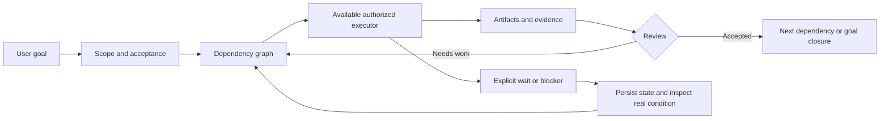

# Bot Orchestrator

Bot Orchestrator helps an agent keep track of a job that takes more than one sitting. It includes a task board, review steps, and a record of what finished, what failed, and what still needs attention.

Maintained by [KarmenLoop](https://github.com/KarmenLoop).

[Download](https://github.com/KarmenLoop/bot-orchestrator/releases/latest) · [Quick start](#quick-start) · [Documentation](docs/README.md) · [Examples](#examples) · [Contributing](CONTRIBUTING.md) · [Support](SUPPORT.md) · [License](LICENSE)


## Overview

Use it when a task has dependencies, several contributors, or a pause that needs to survive the conversation. One coordinator keeps the goal and constraints in view, assigns work when other agents are available and authorized, and checks the files that come back.

The package has three parts:

- An agent skill with instructions for planning, review, and recovery.
- A Python task board that stores tasks and file records in SQLite.
- An optional MoA driver that runs the proposal, review, synthesis, and verification commands you register.

Your agent host supplies models, account access, and permission to act. The board records task state; it does not start a background worker or schedule a wake-up.

## Why use it?

A conversation can say a task is done while the file is still missing. A retry can also repeat an action that already happened.

The board keeps submissions separate from accepted results and ties acceptance to a particular file version. A task marked as running is a record of a start, not proof that its process is still alive. Waiting records describe when work should be checked again; the host must arrange the actual wake-up.

Use the full workflow when those records matter. A small task can be handled directly, without setting up a board or extra roles.

## Capabilities

| Capability | What is included |
| --- | --- |
| Goal intake | Record the intended result, acceptance criteria, scope, constraints, and current progress. |
| Task decomposition | Create independently reviewable deliverables with explicit dependencies and owners. |
| Feasibility and routing | Choose direct execution, dependency tasks, MOA, review, or waiting from the actual acceptance and available tools. |
| Callable MOA | Run proposal, cross-review, synthesis, and verification command adapters under explicit limits. |
| Repeated verification | Require every configured check repetition on one candidate; retain failures and recheck accepted versions without regenerating answers. |
| Conditional collaboration | Coordinate available, authorized workers; fall back to one agent when delegation is unavailable or prohibited. |
| Write coordination | Reject overlapping declared write scopes while another task is running or awaiting review. |
| Deliverable review | Separate submission from acceptance and require actual local files for evidence. |
| Evidence tracking | Pin workspace-relative paths, byte counts, and SHA-256 digests; detect missing or changed files. |
| Next-action diagnosis | Inspect ready tasks, blockers, stale evidence, in-flight records, and due waits; rank reachable required work and suggest a disjoint batch. |
| Recovery | Preserve state across separate process invocations and retain previous accepted submissions when work is reopened. |
| Dependency validation | Recheck the entire accepted ancestor chain before starting, submitting, accepting, or resuming downstream work. |
| Dependency invalidation | Block downstream tasks when an accepted upstream task is reopened. |
| State integrity | Reject malformed current records and cyclic dependencies with structured errors, preserving the stored payload. |
| Bounded attempts | Count execution starts and enforce a configurable per-task attempt limit. |
| Waiting and cancellation | Record reasons, timezone-aware reminder times, and explicit resume transitions. |
| Goal closure | Require accepted mandatory work, settled optional work, and unchanged evidence before closure. |

## What it does not provide

This release is **not** a desktop application, a hosted agent service, a model gateway, an operating-system sandbox, or a background scheduler. The board remains record-only. The separate MOA `run` and `recheck` commands execute the declared adapters and stop their owned local execution resources. They provide cooperative process orchestration, without OS isolation or a hosted model backend.

External tools remain the responsibility of the host. A skill can instruct a host to use an available connector, but it cannot make that connector exist or manufacture an authorization grant. See [capabilities and limitations](docs/limitations.md).

## Quick start

### 1. Download the source

```bash
git clone https://github.com/KarmenLoop/bot-orchestrator.git
cd bot-orchestrator
```

You can download the standalone skill package from [Releases](https://github.com/KarmenLoop/bot-orchestrator/releases/latest), or use GitHub's **Code → Download ZIP** option for the complete repository. Extract the archive before running the examples. The standalone archive includes the skill, references, helper, runnable demonstration, tests, metadata, and license; the repository also includes the installer and project documentation.

**Requirement:** Python 3.9 or newer. The board, installer, local example, and repository checks use only the Python standard library. No API key, package installation, or model subscription is needed for the local demonstration.

On systems where Python is named `python` rather than `python3`, use that executable consistently.

### 2. Run the local demonstration

```bash
python3 examples/local_demo.py
```

For the standalone archive, run `python3 scripts/demo.py` from its extracted skill directory.

The example creates its own temporary workspace and completes a two-task dependency chain:

1. Write a small fact file and check its values.
2. Submit and review that file.
3. Generate a summary from the accepted facts.
4. Check and review the summary.
5. Verify the pinned files and close the overall goal.

It prints the workspace path so you can inspect the actual artifacts and SQLite board. It does not contact a model, publish anything, or modify an existing project.

### 3. Try MOA with real local processes

```bash
python3 examples/moa_demo.py
python3 examples/moa_demo.py --amounts 4 -7 100 --runs 3
```

For the standalone archive, use `python3 scripts/moa_demo.py` from its skill directory.

The offline example computes from actual input files, cross-checks proposals, rejects an intentionally wrong first synthesis, repairs it from feedback, and repeats verification on the corrected candidate. It then performs a separate three-run recheck without calling proposal or synthesis adapters again. All requests, outputs, actual exit codes, candidate digests, and failed observations remain in the printed workspace.

The example explicitly reports **zero model calls**. To connect actual agents or models, use the host's authorized collaboration tools or supply synchronous command adapters through the documented [MOA protocol](skills/bot-orchestrator/references/moa.md). Local process tests establish the invocation and acceptance mechanism; they do not establish model answer quality.

### 4. Install the skill in Codex

```bash
python3 scripts/install_skill.py
```

The default destination is `~/.codex/skills/bot-orchestrator`, or `$CODEX_HOME/skills/bot-orchestrator` when `CODEX_HOME` is set. The installer refuses to overwrite an existing directory.

For a different host, copy the entire `skills/bot-orchestrator` directory to the skill location documented by that host. Keep `SKILL.md`, `references`, `scripts`, and `agents` together. Host-specific import and invocation support must be checked in that environment.

Start a new host session or refresh skill discovery, then try:

```text
Use $bot-orchestrator to complete this goal:
Review the files in the input directory, produce a source-linked findings
table and a concise report, verify both outputs, and preserve a clear
resume point if any required information is missing.
```

The exact invocation syntax depends on the host. A successful local board demonstration does not prove that a particular host's agent, connector, or scheduler is connected.

## Using the task board directly

Choose a workspace that belongs to the current task. The database location is always explicit.

```bash
python3 skills/bot-orchestrator/scripts/board.py \
  --db /absolute/path/to/job/board.sqlite3 \
  init \
  --workspace /absolute/path/to/job \
  --goal "Produce a checked fact table and report" \
  --acceptance "Both files exist, facts retain source references, and report values agree"
```

Add a task:

```bash
python3 skills/bot-orchestrator/scripts/board.py \
  --db /absolute/path/to/job/board.sqlite3 \
  add facts \
  --objective "Extract source-linked facts" \
  --check "Every fact includes its source and uncertainty" \
  --deliverable output/facts-v1.json
```

Inspect it:

```bash
python3 skills/bot-orchestrator/scripts/board.py \
  --db /absolute/path/to/job/board.sqlite3 \
  next
```

Add `--limit 3` to request an advisory batch of up to three disjoint candidates. Ranking counts reachable unfinished required work; user urgency, external resources, and actual cost remain coordinator decisions.

The report lists ready tasks, the first blocker for each blocked candidate, in-flight records, waits, and stale evidence. It does not consume attempts or reserve tasks. Use `status --full` for the stored record and `verify` for a nonzero exit when evidence changed.

All normal command results are JSON. Exit codes are `0` for success, `1` when `verify` detects changed evidence, and `2` for invalid input, lifecycle violations, conflicts, or I/O/format errors.

Read the [complete board reference](skills/bot-orchestrator/references/board.md) for submission, review, waiting, reopening, and goal closure.

## Execution model



The board's task lifecycle is:

```text
pending → running → review → done
   ↑                   │
   └──── rework ────────┘

pending/running/review → waiting | blocked | cancelled
waiting/blocked/cancelled → pending through an explicit resume
done → pending through reopen, with downstream invalidation
```

The coordinator performs actual work through the host's tools. The board does not automatically perform transitions when a time arrives or when a process exits.

## Documentation

Start with the [documentation index](docs/README.md).

| Topic | Guide |
| --- | --- |
| Install, update, and remove | [Installation](docs/installation.md) |
| Workflow responsibilities and storage | [Architecture](docs/architecture.md) |
| Pattern selection and feasibility | [Orchestration decisions](skills/bot-orchestrator/references/orchestration.md) |
| Callable MOA and rechecking | [MOA reference](skills/bot-orchestrator/references/moa.md) |
| Task cards and collaboration | [Execution reference](skills/bot-orchestrator/references/execution.md) |
| Host tools and external actions | [Capabilities reference](skills/bot-orchestrator/references/capabilities.md) |
| State and interruption recovery | [Recovery reference](skills/bot-orchestrator/references/recovery.md) |
| Every board command | [Board reference](skills/bot-orchestrator/references/board.md) |
| Worked scenarios | [Examples](skills/bot-orchestrator/references/examples.md) |
| Guarantees and non-guarantees | [Limitations](docs/limitations.md) |
| Checks and observed coverage | [Validation](docs/validation.md) |
| Common errors | [Troubleshooting](docs/troubleshooting.md) |
| Prepare a release | [Release process](docs/releasing.md) |

## Examples

- **Research and reporting:** extract traceable facts, retain disagreement, write a report, and check its claims.
- **Implementation work:** define deliverables, isolate write ownership, collect relevant test output, and distinguish self-review from independent review.
- **External waiting:** complete independent work, persist the missing condition, and resume the same goal after the condition actually arrives.
- **Uncertain external effects:** inspect the original operation before retrying a message, payment, or submission.
- **Single-agent environments:** execute the same task cards sequentially without inventing unavailable workers.
- **Changed inputs:** reopen upstream work and invalidate the downstream acceptance that depends on it.

See the [worked scenarios](skills/bot-orchestrator/references/examples.md) and run `python3 examples/local_demo.py` for an actual local walkthrough.

## Development and validation

```bash
python3 -B skills/bot-orchestrator/scripts/test_board.py
python3 -B skills/bot-orchestrator/scripts/test_moa.py
python3 -B scripts/test_repository.py
python3 scripts/check_repository.py
python3 examples/local_demo.py
python3 examples/moa_demo.py
python3 scripts/validate.py --repeat 3 --output /absolute/path/to/new-validation-directory
```

The repeated validator preserves each exit code and raw log, stops on a failed check, and verifies that source files remained unchanged. Its output directory must be new and outside the repository.

The tests exercise real local files, SQLite transactions, separate processes, evidence changes, dependency rules, and lifecycle transitions. The repository checker validates Python syntax, documentation links, required files, English-only publication text, and portable examples.

Current local results and platform boundaries are recorded in [validation](docs/validation.md). Do not infer Linux, Windows, native host import, or external connector acceptance from a macOS run. Automated GitHub CI is not claimed unless an actual workflow run is available.

## Contributing

Bug reports, focused fixes, clearer examples, and verified host compatibility reports are welcome. Read [CONTRIBUTING.md](CONTRIBUTING.md) before opening a pull request and follow the [Code of Conduct](CODE_OF_CONDUCT.md).

Keep the core small. A new integration should show the tool contract, its authorization boundary, a real failure case, and an executable verification path. Avoid adding provider-specific account setup or execution behavior to the record-only board. Keep executable MOA behavior in its separate opt-in driver.

## Security

Never post credentials, private transcripts, customer files, or a live task database in a public issue. Use a sanitized reproduction. See [SECURITY.md](SECURITY.md) for vulnerability reporting and the project's trust boundaries.

## Roadmap

These are directions for future work, not present capabilities:

- Verified host-specific import and invocation walkthroughs.
- Additional platform validation with recorded environments.
- Optional adapters to existing task stores and event systems.
- Evidence reference types for externally verifiable artifacts, without turning the board into an authorization authority.

## License

Bot Orchestrator is released under the [MIT License](LICENSE). It is an open-source skill and local helper, with no noncommercial restriction added by this project. Preserve the copyright and license notice when redistributing it.

Dependencies and services supplied by a host retain their own terms. This license does not provide access to model services, external accounts, or third-party tools. See [NOTICE](NOTICE).

## Contact and support

Use this repository's **Issues** tab for reproducible bugs and focused feature requests. For usage questions and compatibility reports, follow [SUPPORT.md](SUPPORT.md).

No response-time guarantee, paid service, donation entitlement, or commercial support commitment is implied by this repository.
