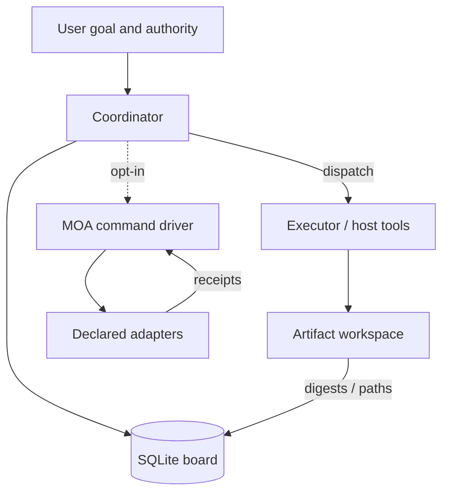

# Bot Orchestrator

[English](README.md) · [中文](README.zh-CN.md) · **v1.2.1**

[](https://github.com/KarmenLoop/bot-orchestrator/actions/workflows/checks.yml)
[](https://github.com/KarmenLoop/bot-orchestrator/releases/latest)
[](https://www.python.org/)
[](LICENSE)
[](skills/bot-orchestrator/SKILL.md)

**Keep a long-running goal on a local task board you can inspect—dependencies, submissions, evidence, review, and recovery—so the next session can verify what changed before continuing.**

Bot Orchestrator is a **portable agent skill** plus a **Python standard-library SQLite board**. The board records state; the host’s tools perform the work. An optional MOA command driver can run declared adapters for proposal, critique, synthesis, repair, and rechecks—without inventing model accounts or background schedulers.

Built and maintained by [KarmenLoop](https://github.com/KarmenLoop) / [KARMENLOOP](https://karmenloop.com). Current release: **[v1.2.1](https://github.com/KarmenLoop/bot-orchestrator/releases/tag/v1.2.1)**. License: **MIT**.


*Real v1.2.1 demonstration output; the temporary workspace path is shown as a placeholder. This is not a host UI screenshot.*

[Download v1.2.1](https://github.com/KarmenLoop/bot-orchestrator/releases/tag/v1.2.1) · [Tutorial](docs/tutorial.en.md) · [中文教程](docs/tutorial.zh-CN.md) · [Architecture](docs/architecture.md) · [Validation](docs/validation.md)

---

## Why this exists

Multi-step agent work collapses when context resets: dependencies are forgotten, “done” means a worker’s claim, waiting is mistaken for a timer, and reopened work leaves stale downstream acceptance.

This package treats orchestration as a **reviewable record**:

- explicit dependency cards and write scopes;
- pinned evidence digests on submissions and acceptance;
- `verify` / reopen that invalidate what no longer holds;
- recovery that inspects real handles before repeating effects;
- optional MOA stages with budgets, receipts, and `NO_PROGRESS` stops.

It does **not** grant host tools, spawn workers, send messages, or schedule wake-ups. Instructions cannot invent those capabilities.

---

## Snapshot

| | |
|---|---|
| **What you install** | Portable skill under `skills/bot-orchestrator/` (`SKILL.md`, `references/`, board/MOA scripts, bilingual onboarding) |
| **What you can run** | `examples/local_demo.py`, `examples/moa_demo.py` (offline, no model account) |
| **Version** | **1.2.1** (`VERSION`, skill metadata, release tag) |
| **Runtime** | Python **3.9+**, standard library only for the board |
| **Storage** | Local SQLite board (schema version **1**); workspace holds deliverables and evidence |
| **Optional driver** | Opt-in MOA command adapters (proposal → critique → synthesis → repeated verification) |
| **CI** | GitHub Actions **Local checks** on Ubuntu / macOS / Windows: board + MOA tests, demos, `check_repository.py`, `check_publication.py` |
| **License** | MIT |

---

## Is / Is not

| Is | Is not |
|---|---|
| Workflow skill + local SQLite task board | Hosted orchestration SaaS or job queue |
| Record of goals, deps, submissions, reviews, waits | Authority to execute tools or spend money |
| Evidence digests and downstream invalidation | Proof that a log’s content is true |
| Opt-in MOA driver over declared commands | Built-in model client or account manager |
| Advisory `next` readiness / batch ranking | Lease, lock service, or duration estimator |
| Offline demos with deterministic programs | Claim that package tests equal host integration |

---

## Architecture

Responsibilities stay separate on purpose:

1. **User** — goal, constraints, authority, preferences.
2. **Coordinator** — retains the goal, chooses work, manages dependencies, accepts with evidence.
3. **Executor** — bounded task via real host tools (may be the coordinator itself).
4. **Host** — tools, sessions, permissions, cancellation, optional scheduling.
5. **Board** — records workflow; transitions are explicit commands and never cause external work.
6. **Optional MOA driver** — declared command adapters with pinned inputs, stage receipts, concurrency/round budgets.
7. **Workspace** — deliverables and evidence; the board stores references and digests.



Each mutation opens a local immediate transaction, validates current-state integrity and the requested transition, then commits. Invalid transitions leave the prior revision intact. This is **not** a distributed coordination system.

Before start, submit, accept, or resume, accepted ancestors—including review evidence—are rechecked. `next` uses the same preflight **without** allocating a lease. Declared write scopes reduce accidental concurrent writes among cooperating callers; they are not an OS permission boundary.

---

## What the skill drives

- **Outcome-first contract** — goal, behavioral acceptance, workspace, scope, constraints, progress.
- **Dependency graph** — cards with IDs, inputs, deliverables, owners, write scopes; parallel only when independent.
- **Execution loop** — select ready work → execute or dispatch → record handles/results → review evidence → recompute.
- **Review discipline** — worker completion is submission, not acceptance; changed artifacts invalidate old passes.
- **Waiting and recovery** — named missing conditions; inspect real operations before repeating effects; reopen invalidates downstream.
- **MOA (optional)** — independent proposals, cross-review, synthesis, repeated verification; failed unchanged digests stop with `NO_PROGRESS`.
- **Close** — user-level acceptance over card counts; settle resources or leave a precise owner.

Command reference: [skills/bot-orchestrator/references/board.md](skills/bot-orchestrator/references/board.md) · decisions: [docs/architecture.md](docs/architecture.md).

### Board lifecycle (record-only)

Typical transitions the included board can record (host tools still do the work):

| Concern | What the board enforces |
|---|---|
| Dependencies | Downstream start/submit/accept only after ancestors are accepted at the current evidence version |
| Evidence | Submissions and acceptance pin relative paths, sizes, and SHA-256 digests |
| Conflicts | Declared write scopes block overlapping in-flight writers among cooperating callers |
| Readiness | `next` reports ready work, blockers, waits, and stale evidence without taking a lease |
| Invalidation | `verify` detects changed digests; reopen accepted work blocks noncancelled downstream cards |
| Attempts | Bounded retries; unchanged failed MOA digests stop with `NO_PROGRESS` instead of endless hope |

### MOA driver (optional)

When explicitly invoked, the driver runs declared adapters through proposal → optional cross-review → synthesis → repeated verification, with concurrency, round, timeout, and stream budgets. It checkpoints process IDs, arguments, exit codes, and stdout/stderr receipts. `recheck` re-runs only verifiers on an accepted candidate hash; `audit` checks hashes and stage identities without executing commands. The offline demo uses deterministic programs and reports **zero model calls**.

---

## Quickstart

**Requirements:** Python **3.9+**. Prefer the release ZIP and verify `SHA256SUMS.txt`.

```sh
python3 examples/local_demo.py
python3 examples/moa_demo.py
```

The first demo creates a real board, writes amounts 17 and 25, checks total 42, reviews two tasks, and closes the goal—then prints the workspace for inspection. The second shows repair and rechecking after a failed round (**zero model calls**).

### Install the skill

```sh
python3 scripts/install_skill.py --destination ../installed-skills/bot-orchestrator
```

Choose a **new** directory (the installer refuses to overwrite). Then load through the host’s supported skill path. The smaller `bot-orchestrator-skill-1.2.1.zip` extracts directly into a skill root and keeps bilingual onboarding.

Long form: [docs/tutorial.en.md](docs/tutorial.en.md) · [docs/installation.md](docs/installation.md).

---

## Documentation map

| Doc | Use it when you need… |
|---|---|
| [Tutorial (EN)](docs/tutorial.en.md) · [中文](docs/tutorial.zh-CN.md) | Download → install → first board |
| [Installation](docs/installation.md) | Skill paths and package layout |
| [Architecture](docs/architecture.md) | Board, evidence, MOA, limits |
| [Limitations](docs/limitations.md) | Honest capability boundaries |
| [Validation](docs/validation.md) | What package tests prove |
| [Troubleshooting](docs/troubleshooting.md) | Common failure modes |
| [Board reference](skills/bot-orchestrator/references/board.md) | Commands and schema |
| [CHANGELOG](CHANGELOG.md) | History through 1.2.1 |
| [SECURITY](SECURITY.md) / [SUPPORT](SUPPORT.md) / [CONTRIBUTING](CONTRIBUTING.md) | Ops |

---

## Validation (honest)

**Hosted CI (`Local checks`)** on push/PR across Ubuntu, macOS, and Windows: `test_board.py`, `test_moa.py`, repository checks, both demos, and `check_publication.py` (bilingual docs must carry version **1.2.1**; bound media digests must match).

**Not claimed**

- native loading or model turns on every agent host;
- remote connectors, timers, or notifications;
- correctness of arbitrary domain logs merely because digests match;
- that package tests equal production orchestration.

See [docs/validation.md](docs/validation.md) and [docs/limitations.md](docs/limitations.md).

---

## FAQ

### What is Bot Orchestrator, in one sentence?

A source-available **orchestration skill** with a local SQLite task board for dependencies, submissions, evidence, review, waiting, and recovery—plus an optional offline MOA command driver.

### Does a wait create a timer?

No. A real scheduler or a manual check must resume work. Installation registers no background task and grants no external-action authority.

### Where is the data?

`--db` selects the database. Deliverables and evidence stay in the chosen workspace. Keep live boards and private files out of public repositories.

### Is the board an executor?

No. The board is **record-only**. Host tools perform the job. The MOA driver only supervises commands it directly starts when explicitly invoked.

### Soft discoverability

Matching phrases: **local agent task board**, **SQLite dependency orchestration**, **submission evidence digest**, **MOA offline verification**, **agent recovery after reopen**. The method is in the skill and board—not keyword stuffing.

---

## License and contact

[MIT License](LICENSE) · [NOTICE](NOTICE)

Maintainer: [KarmenLoop](https://github.com/KarmenLoop) · Site: [karmenloop.com](https://karmenloop.com)

Issues: [GitHub Issues](https://github.com/KarmenLoop/bot-orchestrator/issues) · Support: [SUPPORT.md](SUPPORT.md).
