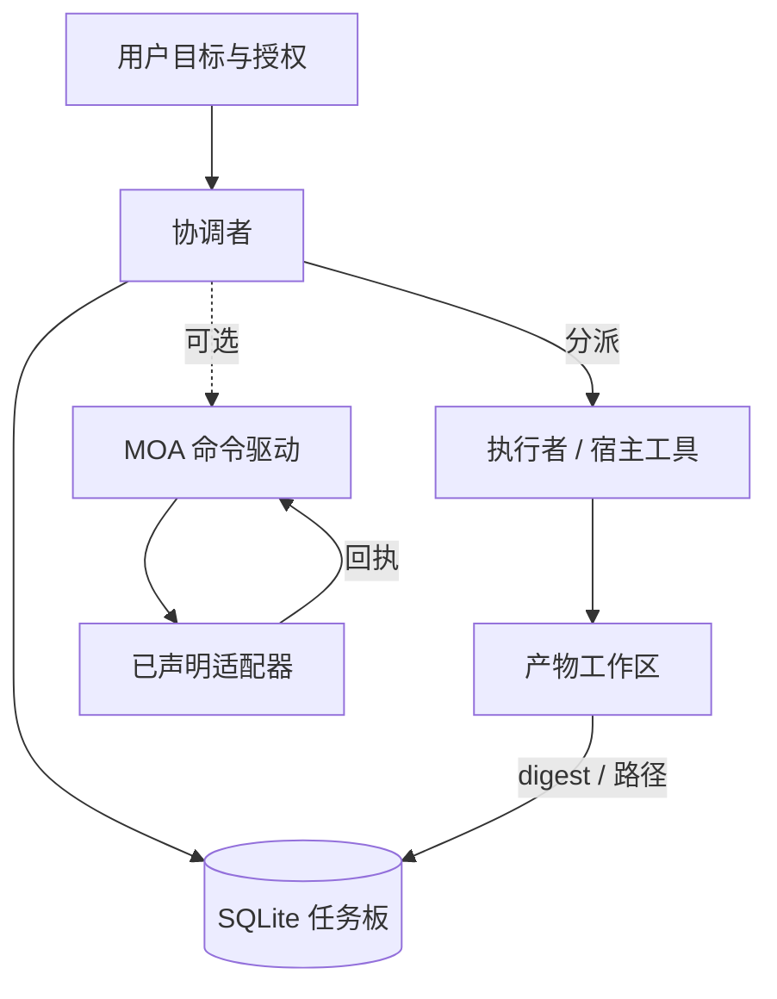

# Bot Orchestrator · 机器人编排器

[English](README.md) · [中文](README.zh-CN.md) · **v1.2.1**

[](https://github.com/KarmenLoop/bot-orchestrator/actions/workflows/checks.yml)
[](https://github.com/KarmenLoop/bot-orchestrator/releases/latest)
[](https://www.python.org/)
[](LICENSE)
[](skills/bot-orchestrator/SKILL.md)

**把跨多次会话的目标留在一块可检查的本地任务板上——依赖、交件、证据、审阅与恢复——下一会话继续前，先核对哪些证据已经变化。**

Bot Orchestrator 是一套可移植的 **Agent Skill**，外加仅依赖 Python 标准库的 **SQLite 任务板**。任务板记录状态；真正的执行仍由宿主工具完成。可选的 MOA 命令驱动可按声明的适配器跑候选、互评、综合、修复与复检——不内置模型账号，也不注册后台调度。

由 [KarmenLoop](https://github.com/KarmenLoop) / [KARMENLOOP](https://karmenloop.com) 维护。当前版本：**[v1.2.1](https://github.com/KarmenLoop/bot-orchestrator/releases/tag/v1.2.1)**。许可：**MIT**。


*v1.2.1 真实演示输出；临时工作目录显示为占位符。这不是宿主界面截图。*

[下载 v1.2.1](https://github.com/KarmenLoop/bot-orchestrator/releases/tag/v1.2.1) · [中文教程](docs/tutorial.zh-CN.md) · [English guide](docs/tutorial.en.md) · [架构](docs/architecture.md) · [验收](docs/validation.md)

---

## 为什么做这个

多步 Agent 工作在上下文重置时容易塌掉：依赖被遗忘、「完成」只是执行方自报、等待被误当成定时器，重开上游却留下失效的下游验收。

本仓库把编排当成 **可审阅的记录**：

- 明确的依赖卡片与写入范围；
- 交件与验收上的证据摘要（digest）；
- `verify` / reopen 使不再成立的验收失效；
- 恢复前先检查真实句柄，再决定是否重做；
- 可选 MOA 阶段带预算、回执，并以 `NO_PROGRESS` 停止无效重试。

它**不会**授予宿主工具、拉起协作者、发消息或安排唤醒。说明文字无法凭空创造这些能力。

---

## 一览

| | |
|---|---|
| **安装内容** | `skills/bot-orchestrator/` 可移植 Skill（`SKILL.md`、`references/`、任务板/MOA 脚本、双语入门） |
| **可运行示例** | `examples/local_demo.py`、`examples/moa_demo.py`（离线，无模型账号） |
| **版本** | **1.2.1**（`VERSION`、技能元数据、发布标签） |
| **运行时** | Python **3.9+**；任务板仅用标准库 |
| **存储** | 本地 SQLite 任务板（schema **1**）；工作区存放交件与证据 |
| **可选驱动** | 可选 MOA 命令适配器（提议 → 互评 → 综合 → 重复核验） |
| **CI** | GitHub Actions **Local checks**（Ubuntu / macOS / Windows）：任务板 + MOA 测试、演示、`check_repository.py`、`check_publication.py` |
| **许可** | MIT |

---

## 是什么 / 不是什么

| 是 | 不是 |
|---|---|
| 工作流 Skill + 本地 SQLite 任务板 | 托管编排 SaaS 或作业队列 |
| 目标、依赖、交件、审阅、等待的记录 | 执行工具或花钱的授权 |
| 证据 digest 与下游失效 | 证明日志内容本身正确 |
| 面向已声明命令的可选 MOA 驱动 | 内置模型客户端或账号管理 |
| 只读的 `next` 就绪 / 批次建议 | 租约、锁服务或工期估算器 |
| 确定性程序的离线演示 | 包测试等同宿主集成通过 |

---

## 架构

职责刻意分开：

1. **用户** — 目标、约束、授权、偏好。
2. **协调者** — 持有目标、选择工作、管理依赖、按证据验收。
3. **执行者** — 通过真实宿主工具完成有界任务（也可以是协调者自己）。
4. **宿主** — 工具、会话、权限、取消、可选调度。
5. **任务板** — 记录工作流；状态迁移是显式命令，**不会**触发外部动作。
6. **可选 MOA 驱动** — 已声明命令适配器，固定输入、阶段回执、并发/轮次预算。
7. **工作区** — 交件与证据；任务板只存引用与 digest。



每次变更开启本地立即事务，校验当前状态完整性与请求迁移，再提交。非法迁移保留上一版本。这不是分布式协调系统。

在 start / submit / accept / resume 前，会重检已接受祖先（含审阅证据）。`next` 使用同一预检，但**不**占用租约。声明的写入范围只降低协作方误写风险，不是操作系统权限边界。

---

## Skill 实际推动什么

- **结果优先契约** — 目标、行为化验收、工作区、范围、约束、进度。
- **依赖图** — 含 ID、输入、交件、负责人、写入范围的卡片；仅在独立时并行。
- **执行循环** — 选就绪工作 → 执行或分派 → 记录句柄/结果 → 审阅证据 → 重算下一步。
- **审阅纪律** — 执行方「完成」只是交件，不是验收；产物变更会使旧通过失效。
- **等待与恢复** — 写明缺失条件；重做前检查真实操作；reopen 使下游验收失效。
- **MOA（可选）** — 独立候选、互评、综合、重复核验；未改动的失败 digest 以 `NO_PROGRESS` 停止。
- **收口** — 以用户级验收为准，而非卡片数量；结算资源或留下明确负责人。

命令参考：[skills/bot-orchestrator/references/board.md](skills/bot-orchestrator/references/board.md) · 决策与边界：[docs/architecture.md](docs/architecture.md)。

### 任务板生命周期（纯记录）

内置任务板可记录的典型迁移（真正干活的仍是宿主工具）：

| 关注点 | 任务板实际约束 |
|---|---|
| 依赖 | 仅当祖先在当前证据版本下已接受，下游才可 start/submit/accept |
| 证据 | 交件与验收固定相对路径、字节数与 SHA-256 digest |
| 冲突 | 声明的写入范围阻止协作方重叠的在途写入 |
| 就绪 | `next` 报告就绪工作、阻塞、等待与陈旧证据，不占用租约 |
| 失效 | `verify` 发现 digest 变化；reopen 已接受工作会阻断未取消的下游卡片 |
| 尝试 | 有界重试；未改动的失败 MOA digest 以 `NO_PROGRESS` 停止，避免空转 |

### MOA 驱动（可选）

显式调用时，驱动按已声明适配器跑：提议 → 可选互评 → 综合 → 重复核验，并带并发、轮次、超时与流预算。它会记录进程 ID、参数、退出码与 stdout/stderr 回执。`recheck` 只对已接受候选哈希重跑核验器；`audit` 检查哈希与阶段身份而不执行命令。离线演示使用确定性程序，报告 **零模型调用**。

---

## 快速开始

**要求：** Python **3.9+**。建议下载发布 ZIP 并核对 `SHA256SUMS.txt`。

```sh
python3 examples/local_demo.py
python3 examples/moa_demo.py
```

第一个示例真实创建任务板、写入金额 17 与 25、检查总和 42、审阅两项任务并关闭目标，然后打印工作目录便于查看产物。第二个示例展示失败后的修复与复检（**零模型调用**）。

### 安装技能

```sh
python3 scripts/install_skill.py --destination ../installed-skills/bot-orchestrator
```

选择**新**目录（安装器拒绝覆盖）。再按宿主支持的方式加载。较小的 `bot-orchestrator-skill-1.2.1.zip` 可直接解压到技能根目录，并保留双语入门文档。

长文：[docs/tutorial.zh-CN.md](docs/tutorial.zh-CN.md) · [docs/installation.md](docs/installation.md)。

---

## 文档地图

| 文档 | 何时查阅 |
|---|---|
| [中文教程](docs/tutorial.zh-CN.md) · [English](docs/tutorial.en.md) | 下载 → 安装 → 第一块任务板 |
| [安装](docs/installation.md) | 技能路径与包布局 |
| [架构](docs/architecture.md) | 任务板、证据、MOA、边界 |
| [限制](docs/limitations.md) | 诚实能力边界 |
| [验收](docs/validation.md) | 包测试证明什么 |
| [排障](docs/troubleshooting.md) | 常见失败模式 |
| [任务板参考](skills/bot-orchestrator/references/board.md) | 命令与 schema |
| [CHANGELOG](CHANGELOG.md) | 至 1.2.1 的历史 |
| [SECURITY](SECURITY.md) / [SUPPORT](SUPPORT.md) / [CONTRIBUTING](CONTRIBUTING.md) | 运维 |

---

## 验收（诚实）

**托管 CI（`Local checks`）** 在 push/PR 上覆盖 Ubuntu、macOS、Windows：`test_board.py`、`test_moa.py`、仓库检查、两个演示，以及 `check_publication.py`（双语文档须含版本 **1.2.1**；绑定媒体 digest 须匹配）。

**不声称**

- 每个 Agent 宿主的原生加载或模型回合；
- 远程连接器、定时器或通知；
- 仅因 digest 匹配就证明任意领域日志正确；
- 包测试等同生产编排。

见 [docs/validation.md](docs/validation.md) 与 [docs/limitations.md](docs/limitations.md)。

---

## 常见问题

### 一句话说明？

源码可见的 **编排 Skill**，配本地 SQLite 任务板，用于依赖、交件、证据、审阅、等待与恢复；另有可选的离线 MOA 命令驱动。

### 等待会创建定时器吗？

不会。需要真实调度器或人工复查才能继续。安装不注册后台任务，也不授予对外操作权限。

### 数据在哪里？

数据库由 `--db` 指定；交件与证据留在所选工作区。不要把真实任务库或私人文件提交到公共仓库。

### 任务板会执行命令吗？

不会。任务板是 **纯记录**。宿主工具才执行工作。MOA 驱动仅在显式调用时监督它直接启动的命令。

### 可发现性（轻量）

与本仓实质相符的表述：**本地 Agent 任务板**、**SQLite 依赖编排**、**交件证据 digest**、**离线 MOA 核验**、**reopen 后的 Agent 恢复**。方法在 Skill 与任务板里，不在堆砌关键词。

---

## 许可与联系

[MIT License](LICENSE) · [NOTICE](NOTICE)

维护者：[KarmenLoop](https://github.com/KarmenLoop) · 站点：[karmenloop.com](https://karmenloop.com)

议题：[GitHub Issues](https://github.com/KarmenLoop/bot-orchestrator/issues) · 支持：[SUPPORT.md](SUPPORT.md)。
