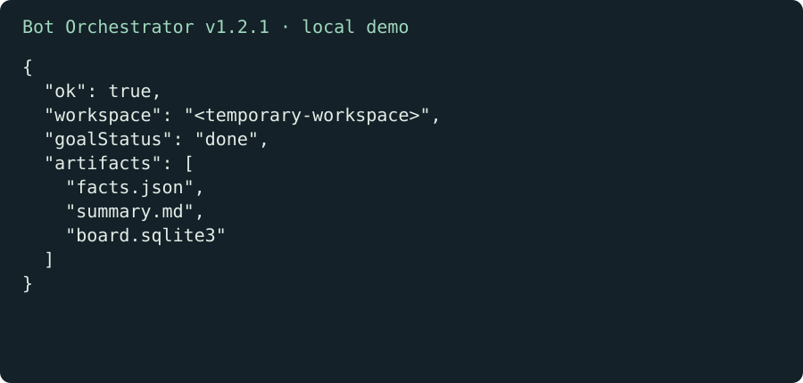

# Bot Orchestrator

English | [简体中文](README.zh-CN.md)

Keep a long-running job on a task board you can inspect. Tasks, dependencies, submissions, and review decisions live in SQLite, so the next session can check what changed before continuing.

[Download v1.2.1](https://github.com/KarmenLoop/bot-orchestrator/releases/tag/v1.2.1) · [Tutorial](docs/tutorial.en.md) · [Issues](https://github.com/KarmenLoop/bot-orchestrator/issues)

## What it does

Dependent tasks become ready after their prerequisites are accepted. Verification detects changes to recorded evidence, and reopening work invalidates downstream acceptance. The board records state; the host’s tools perform the actual job.

A separate opt-in MOA driver can call explicitly configured adapters for candidate generation, review, repair, and rechecks. The offline example uses local subprocesses and no model account.



*Actual v1.2.1 demonstration summary; the temporary workspace path is represented by a placeholder. This is not a host UI screenshot.*

## Start here

Download bot-orchestrator-v1.2.1.zip, verify SHA256SUMS.txt, and extract it. Use Python 3.9+:

```sh
python3 scripts/demo.py
python3 scripts/moa_demo.py
```

The first example creates a real board, writes amounts 17 and 25, checks the total 42, reviews two tasks, and closes the goal. It prints the workspace so you can inspect the artifacts. The second shows repair and rechecking after a failed round.

## Install the skill

```sh
python3 scripts/demo.py
```

This is the standalone skill folder. Copy it to a new host-supported skill directory, retaining its references and notices. The smaller bot-orchestrator-skill-1.2.1.zip can be extracted directly into a skill root and retains bilingual onboarding docs.

## Questions

**Does waiting create a timer?** No. A real scheduler or a manual check must resume the work. Installation registers no background task and grants no external-action authority.

**Where is the data?** The --db argument selects the local database. Deliverables and evidence stay in the chosen workspace. Keep live task databases and private files out of public repositories.

## Documentation and license

[Download through advanced use](docs/tutorial.en.md) · [Command reference](references/board.md) · [MIT](LICENSE) · [NOTICE](NOTICE)

Host behavior, models, connectors, and real-device acceptance need their own checks. Package tests do not establish an external integration.
